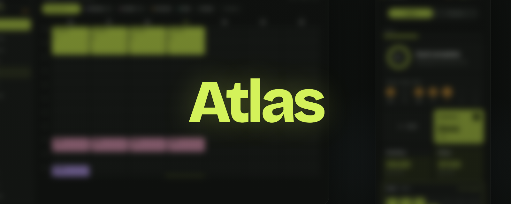
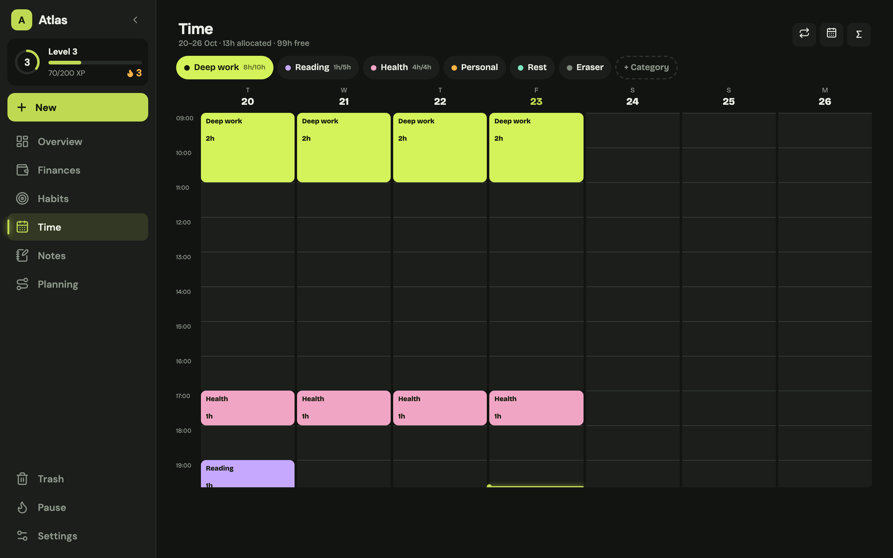
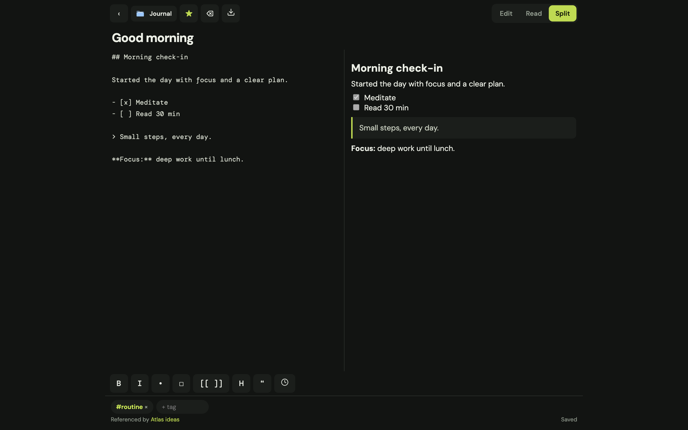
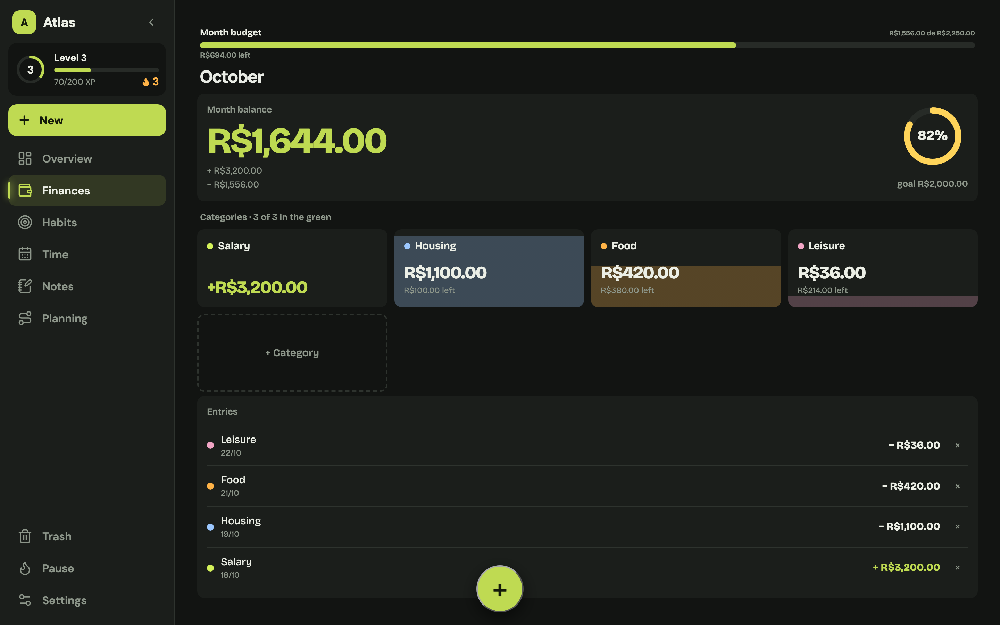
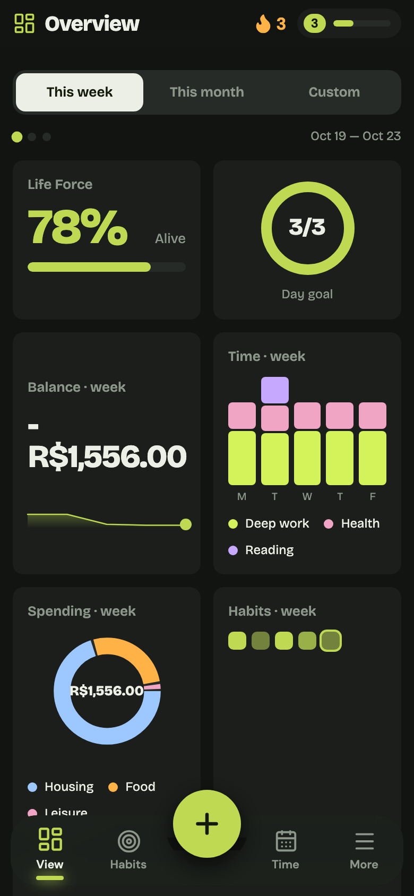
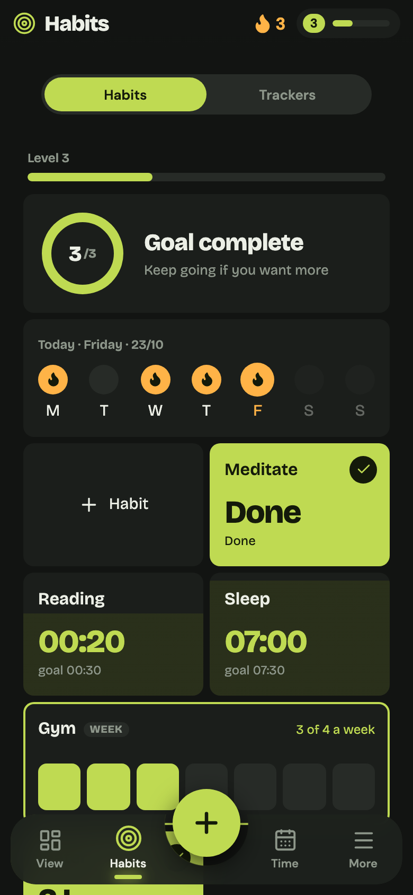

# Atlas

<p align="center">
  
</p>

<p>
  <a href="https://github.com/ReinaldoAssis/Atlas/actions/workflows/ci.yml"></a>
  <a href="https://github.com/ReinaldoAssis/Atlas/releases"></a>
  <a href="LICENSE"></a>
  
</p>

**Atlas is a local-first personal space for finances, habits, time, notes, and the connections between them.** No account, no cloud, no subscription — your data stays on your device and can sync directly between paired devices on the same network.



<p align="center">
  <em>Português? Leia o <a href="README.pt-BR.md">README em pt-BR</a>.</em>
</p>

## Why Atlas

- **One place for the day.** Finances, habits, time blocks, notes, and a life graph share the same local snapshot.
- **Fast to capture.** One gesture or short form; feedback with motion, sound, and haptics.
- **Local-first by design.** SQLite on device, manual backups, optional encrypted backup.
- **Private sync.** Direct device-to-device pairing over the LAN with a 6-digit SAS; no relay.
- **Built to be owned.** GPL-3.0, open source, no telemetry.

## Features

- **Dashboard** — balance, habits, time allocation, goals, streaks, and life-force progress.
- **Finances** — income/expense entries, categories, monthly limits, savings goal, undo.
- **Habits** — boolean, count, duration and weekly habits; history, streaks, and XP.
- **Trackers** — weight, mood, sleep, measurements; multiple entries per day.
- **Time planner** — paint time blocks, 7-day rolling window, range calendar (up to 14 days), notes per block.
- **Notes** — Markdown editor (Carta), folders, tags, wiki-links, backlinks, attachments, trash, Markdown export.
- **Life graph** — domains, nodes, and edges tied to real records.
- **Sync** — LAN peer discovery, SAS pairing, cursor deltas, LWW merge, conflict copies.
- **Feedback** — sound/haptics preferences, reduced-motion support, test mode with a separate database.

## Screenshots

All images are generated from the production build in test mode:
`npm run shots` (requires Google Chrome).

<table>
  <tr>
    <td width="33%" align="center"><br><sub>Time planner</sub></td>
    <td width="33%" align="center"><br><sub>Notes · editor and preview</sub></td>
    <td width="33%" align="center"><br><sub>Finances</sub></td>
  </tr>
</table>

<table>
  <tr>
    <td width="25%" align="center"><br><sub>Dashboard</sub></td>
    <td width="25%" align="center"><br><sub>Habits</sub></td>
  </tr>
</table>

## Stack

- **SvelteKit + Svelte 5 + TypeScript**, static build
- **Tauri 2** for iOS, macOS, and Windows
- **SQLite** in the packaged app; browser storage only in the web preview
- **Carta** for Markdown rendering, **Paraglide** for pt-BR copy
- **Vitest** (unit + component) and **Rust** tests

## Getting started

### Web preview

```sh
npm install
npm run dev
```

The web preview uses browser storage and is meant for UI work; it is not a
packaged install.

### Tauri app

```sh
npm run tauri:dev
```

You need the Rust toolchain and the native dependencies for your platform.
iOS builds require macOS and Xcode.

### Checks

```sh
npm run check                 # svelte-check + sync + i18n
npm test                      # Vitest: node unit + jsdom components
cargo test --manifest-path src-tauri/Cargo.toml --locked
npm run build && npm run csp:check
```

## Platforms

| Platform | Status | Distribution |
|---|---|---|
| **iOS** | Supported | Unsigned `.ipa` via SideStore — [guide](docs/IOS-SIDELOAD.md) |
| **macOS** | Supported | Local `.app`/`.dmg` build script |
| **Windows** | Supported | NSIS per-user installer, unsigned — [guide](docs/WINDOWS-INSTALLER.md) |

Releases are semver tags; the Windows updater consumes the signed release
artifacts. See [docs/RELEASES.md](docs/RELEASES.md).

## Data and privacy

The packaged app stores everything in a local SQLite database. Backups are
manual and can be plain `.zip` or encrypted JSON. Sync is optional, direct
between paired devices, and never goes through Atlas servers. The web preview
uses local browser storage.

## Documentation

Start at [docs/README.md](docs/README.md). Product scope is in
[docs/MVP.md](docs/MVP.md), UI rules in [docs/DESIGN.md](docs/DESIGN.md), and
the delivered/upcoming slices in [docs/ROADMAP.md](docs/ROADMAP.md).

## Contributing

The repository is personal but open source. Branch from `main`, keep
`npm run check`, `npm test`, and `npm run build` green, and open a PR. Read
[AGENTS.md](AGENTS.md) for conventions and environment gotchas.

## License

[GPL-3.0](LICENSE).
